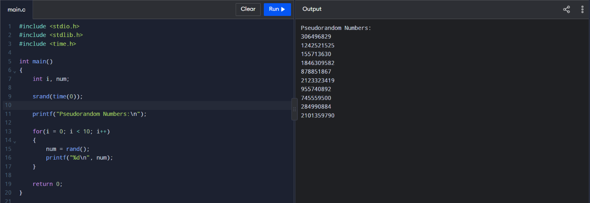

# EX-NO-6-Pseudo-Random-Number

### Name: M.Vetrivel
### Register Number: 212225040487
### Date: 18-11-2026

# AIM: 
Implementation of Pseudorandom Number Generation Using Standard library

# ALGORITHM:
Start the program and import the required libraries.
Seed the random number generator using the current time(i.e) rand(time(0));
Get the number of randon number to generate.
Pass the value for number of iterations and print the numbers.
End the program.

# PROGRAM:
```c
#include <stdio.h>
#include <stdlib.h>
#include <time.h>

int main()
{
    int i, num;

    srand(time(0));

    printf("Pseudorandom Numbers:\n");

    for(i = 0; i < 10; i++)
    {
        num = rand();
        printf("%d\n", num);
    }

    return 0;
}


```

# OUTPUT:



# RESULT:
Implementation of Pseudorandom Number Generation Using Standard library is executed sucessfully.

